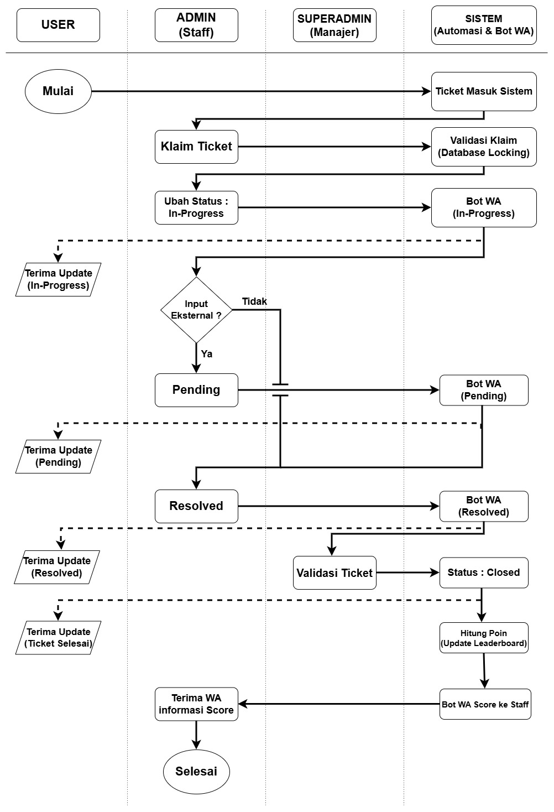
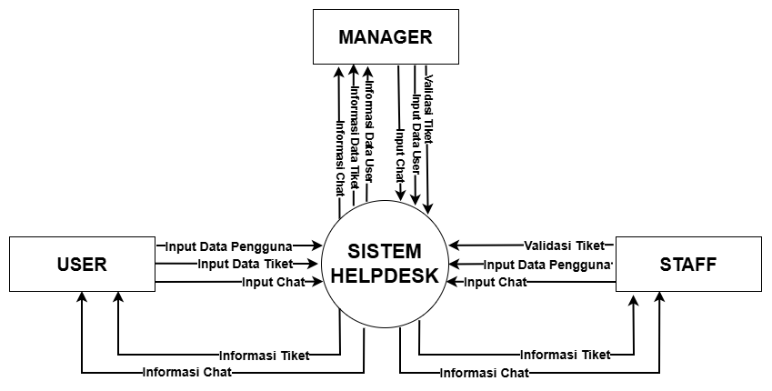
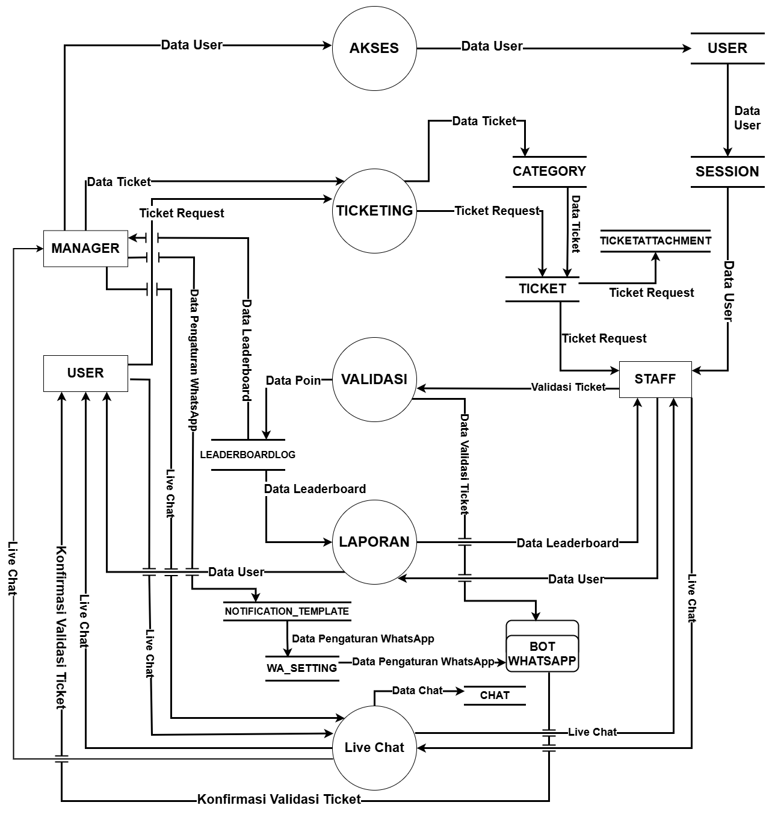
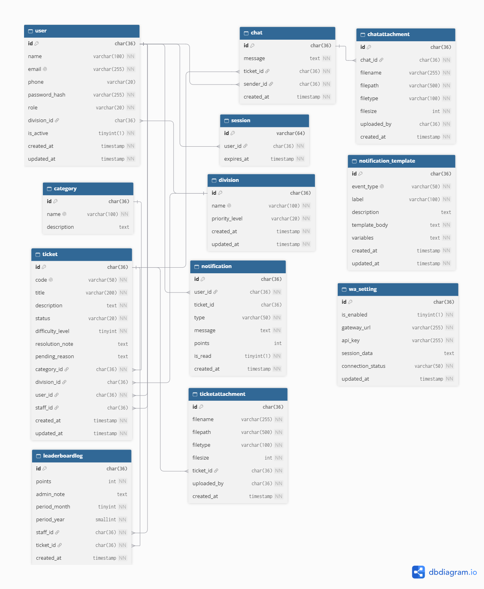

# Pemodelan Sistem & Arsitektur (System Modeling)

## Sistem Bantuan & Layanan IT Support (Helpdesk Ticketing System)

Dokumen ini memuat perancangan alur kerja, aliran data, serta basis data dari sistem helpdesk ticketing untuk memberikan pemahaman bagi kepentingan tim pengembang.

---

## Flowchart Sistem
Diagram alur kerja sistem operasional helpdesk ticketing yang mendefinisikan tahapan penanganan kendala dan pelaporan kendala secara sekuensial.

Keterangan Alur :
- **Pengajuan Tiket Kendala:** Pengguna mengajukan tiket baru melalui laman sistem dengan melampirkan keterangan kronologi kendala.
- **Klaim & Penanganan Tiket:** Staff IT (Admin) melakukan klaim tiket masuk, memperbarui status menjadi In-Progress, Pending, hingga Resolved.
- **Validasi & KPI:** Superadmin/Manager melakukan validasi akhir tiket teratasi untuk memicu kalkulasi poin otomatis ke Leaderboard.

## Diagram Konteks
Diagram yang menggambarkan batasan sistem secara makro dengan memetakan interaksi data antara aktor eksternal dan pusat sistem.

Entitas yang terlibat :
- **Manajer IT (Superadmin):** Berperan melakukan monitoring menyeluruh, validasi akhir, serta pengaturan hak akses sistem.
- **Staff IT Support (Admin):** Mengirimkan validasi penanganan tiket dan input chat, serta memantau progres operasional helpdesk.
- **Staff Divisi lain (User): Mengirimkan data pengguna, data tiket, dan input chat, serta menerima pembaruan status tiket dan pesan komunikasi.

## Data Flow Diagram (DFD) Level 1
Diagram Alir Data Level 1 memetakan dekomposisi proses operasional utama ke dalam subsistem fungsional yang terhubung dengan penyimpanan data internal.

Aktivitas / proses yang terlibat :

- **Proses 1.0 (Akses):** Mengelola autentikasi pengguna dan manajemen sesi aktif (`user`, `session`).
- **Proses 2.0 (Ticketing):** Mengelola pengajuan tiket, kategori, serta berkas lampiran (`ticket`, `category`, `ticketattachment`).
- **Proses 3.0 (Live Chat & Validasi):** Menangani komunikasi dua arah dan verifikasi penyelesaian insiden (`chat`, `leaderboardlog`). 
- **Proses 4.0 (Bot WhatsApp & Laporan):** Mengelola otomasi pengiriman pesan berdasarkan konfigurasi templat (`wa_setting`, `notification_template`).

## Relasi Basis Data
Perancangan skema basis data relasional  yang menghubungkan entitas operasional guna menjamin integritas data sistem helpdesk.

Tabel Utama yang Digunakan:

- **user & division:** Menyimpan informasi profil pengguna, kredensial login, nomor induk, serta pengelompokan divisi.
- **ticket & category:** Menyimpan informasi pelaporan kendala, tingkat prioritas, dan relasi kategori kendala.
- **chat, ticketattachment & chatattachment:** Menyimpan riwayat komunikasi dua arah beserta berkas lampiran pendukung.
- **leaderboardlog:** Mencatat akumulasi perolehan poin KPI dari penyelesaian tiket staff.
- **wa_setting & notification_template:** Mengatur konfigurasi integrasi bot WhatsApp dan templat pesan otomatis.
